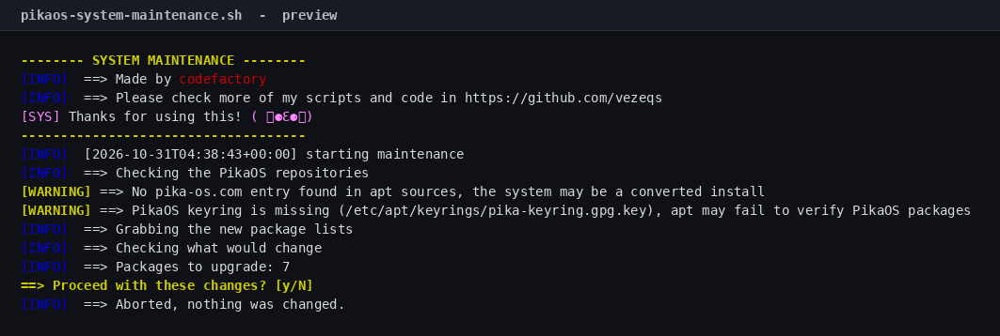
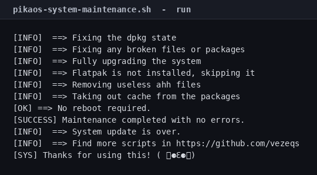

# PikaOS System Maintenance Script

[](LICENSE)
[](#tested-on)

One command to update, clean and repair PikaOS. It checks the PikaOS
repositories, updates Flatpak alongside apt, shows you what will change,
**asks before touching anything**, and tells you if a reboot is needed.



## Quick start

```bash
git clone https://github.com/vezeqs/pikaos-system-maintenance.git
cd pikaos-system-maintenance
sudo ./pikaos-system-maintenance.sh
```

## What it does

| # | Step | Command |
|---|------|---------|
| 1 | Check the PikaOS apt source and keyring | `/etc/apt/sources.list*`, `/etc/apt/keyrings/pika-keyring.gpg.key` |
| 2 | Refresh package lists (3 attempts) | `apt-get update` |
| 3 | Show what would change | `apt-get -s full-upgrade`, `apt-get -s autoremove`, `flatpak remote-ls --updates` |
| 4 | **Ask for confirmation** | `Proceed? [y/N]` |
| 5 | Repair an interrupted dpkg state | `dpkg --configure -a` |
| 6 | Repair broken dependencies | `apt-get --fix-broken install` |
| 7 | Upgrade everything | `apt-get full-upgrade` |
| 8 | Update Flatpak apps | `flatpak update -y` |
| 9 | Remove unused packages **and their configs** | `apt-get autoremove --purge` |
| 10 | Clean the package cache | `apt-get autoclean` |
| 11 | Check for a pending reboot | `/var/run/reboot-required` |

## PikaOS specifics

PikaOS is Debian Sid with its own repositories, keyring, kernel builds and
Flatpak setup. This script adds three things the Debian script does not do:

- **It checks that `pika-os.com` is in your apt sources** and warns if the
  system looks converted from plain Debian.
- **It checks that the PikaOS keyring is present** at
  `/etc/apt/keyrings/pika-keyring.gpg.key` (or that the `pika-keyring` package
  is installed) and warns if apt may not be able to verify PikaOS packages.
- **It updates Flatpak apps** after the apt upgrade, because PikaOS ships
  Flatpak as part of the desktop.

Both repository checks are warnings, not failures. A converted install should
still be able to upgrade.

## The confirmation prompt

Nothing is installed, removed or purged until you answer `y`. Before asking, the
script prints how many packages would be upgraded, which ones would be removed,
which unused packages would be purged, and how many Flatpak apps are behind:


Answer anything but `y` and it exits with `nothing was changed`.

## Options

| Flag | Effect |
|------|--------|
| `-y`, `--yes` | Skip the confirmation prompt (cron, unattended runs) |
| `-n`, `--dry-run` | Print every command without running it |
| `-h`, `--help` | Show usage |

Without `-y`, the script refuses to run if there is no terminal to confirm on,
so a cron job fails loudly instead of upgrading silently.

## Example

A real run against a `debian:sid` container, 7 packages behind:



## Requirements

- PikaOS (Debian Sid base)
- root (`sudo`)
- Bash 4.0+ (default everywhere)
- `flatpak` is optional; the step is skipped when it is not installed

## Safety notes

- **Your config files are kept.** Every `apt-get` call passes
  `-o Dpkg::Options::=--force-confdef -o Dpkg::Options::=--force-confold`, so dpkg
  never stops to ask which version of a config file to keep.
- **`autoremove` runs with `--purge`**, so config files of removed packages are
  deleted too. Drop `--purge` from that line if you would rather keep them.
- **`needrestart` is set to automatic** (`NEEDRESTART_MODE=a`), so the Debian 12+
  apt hook cannot block the upgrade.
- **`--dry-run` never changes anything**, including the preview queries.
- **Fails fast.** `set -euo pipefail` plus an `ERR` trap that reports the failing
  command and its exit status.

## Tested on

| Image | Result |
|-------|--------|
| `debian:sid` (the PikaOS base), 7 packages | Upgrade, autoremove and cache clean completed; no reboot required |

The screenshot is from a plain Debian Sid container, not a PikaOS ISO. That is
why it shows the "no pika-os.com entry" and "PikaOS keyring is missing"
warnings: those checks are supposed to pass on a real PikaOS install, and they
warn rather than fail when they do not. PikaOS reports `ID=pika`; the script
accepts both `pika` and `pikaos`.

## Verify it yourself

```bash
make check
```

`make check` runs `bash -n`, shellcheck when installed, the smoke tests, the
PikaOS identity/keyring regression test and the asset check. The screenshots
come from a real `debian:sid` container:

```bash
podman run --rm -v "$PWD:/repo:ro,Z" debian:sid \
  bash /repo/pikaos-system-maintenance.sh --dry-run
```

## Limits

- It does not roll back. Take a snapshot first if you need one.
- It does not switch kernels or schedulers; that is Pika Kernel Manager.
- It does not replace Pikman, the graphical update manager.
- It was tested on Debian Sid, the PikaOS base, not on a PikaOS ISO.

## License

MIT — see [LICENSE](LICENSE).

## Author

**codefactory** — [github.com/vezeqs](https://github.com/vezeqs)
